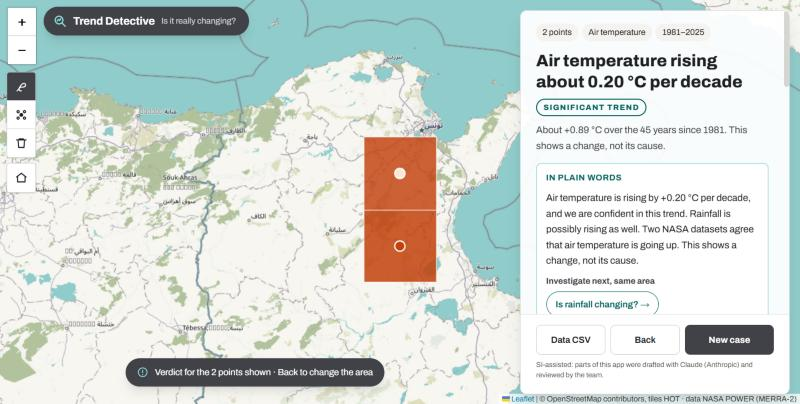
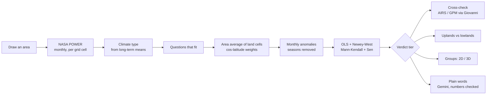
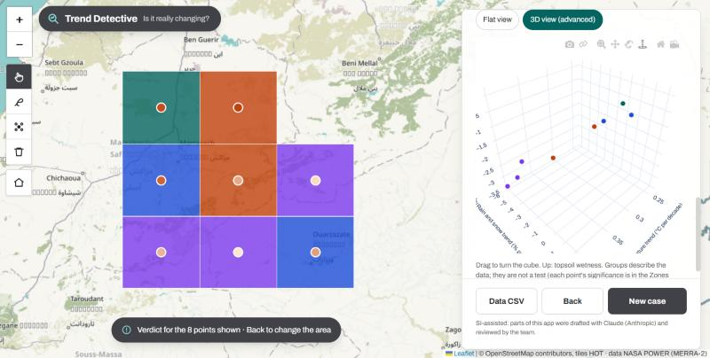

# Trend Detective

**Is it really changing?** Draw any area on a world map, pick a question that fits the place, and get an honest,
plain-language verdict from 45 years of NASA data. The verdict is tested twice and checked against a second NASA
dataset.

*NASA Space Apps Challenge 2026: Be An Earth System Trend Detective!*



## What it does

| You do | The app does |
|---|---|
| Drag the map and draw a loop around an area (or tap grid cells) | Fetches each NASA POWER grid cell (0.5° × 0.625°) and skips the sea |
| Wait about 2 seconds | Reads the area's **climate from its own NASA averages** and suggests the questions that matter there: snow and cold nights in Canada, extreme heat and drying soil in a desert |
| Click **Investigate** | Tests the trend two ways, gives a verdict (**significant**, **possible** or **no clear trend**) and the rate per decade with its 95% range |
| Read on | A **second NASA dataset** checks the result, mountains are compared with lowlands, and points that change alike are grouped on the map |

### Highlights

- **Two tests, one verdict.** A trend is *significant* only when both a straight-line test (OLS with Newey-West
  errors) and a rank test (Mann-Kendall, Hamed-Rao) give p < 0.05 and agree on its direction.
- **Cross-check with an independent instrument.** Temperature from MERRA-2 is compared with the **AIRS** satellite;
  rain and snow with **GPM IMERG**. Both come live from NASA Giovanni over the years the two datasets share.
- **Questions that fit the place.** Cold and snowy, desert, warm and dry, hot and humid, or temperate. The type is
  read from the area's own data, not from a list of countries, so the Alps and the Rockies get the same questions.
- **Uplands vs lowlands.** When the points span 500 m or more of elevation, each half is tested on its own.
  "Faster" or "slower" is only said when the 95% ranges don't overlap.
- **Groups.** Every grid cell is tested on three variables, and cells that change alike share a colour on the map,
  in a flat 2D plot and in an optional 3D view.
- **Plain words.** A short summary for non-experts, written by Google Gemini from the app's own numbers. Any number
  or claim the app didn't compute is rejected and a template is used instead.


## How it works



## Data

| Source | Variables | Years | Access |
|---|---|---|---|
| [NASA POWER](https://power.larc.nasa.gov/) (MERRA-2 reanalysis), monthly point API | Air temperature `T2M`, hottest / coldest of the month `T2M_MAX` / `T2M_MIN`, frost days `FROST_DAYS`, rain and snow `PRECTOTCORR`, snowfall `PRECSNOLAND`, snow depth `SNODP`, topsoil wetness `GWETTOP`, relative humidity `RH2M`, plus cell elevation | 1981–2025 | No login |
| **AIRS** on NASA's Aqua satellite (`AIRS3STM` v7.0), via [Giovanni](https://giovanni.gsfc.nasa.gov/) | Surface air temperature, mean of day and night passes, K → °C | 2002–2025 | Earthdata Login |
| **GPM IMERG** monthly (`GPM_3IMERGM` v07), via Giovanni | Precipitation, mm/hr → mm/day | 1998–2025 | Earthdata Login |

The units and names were checked against NASA's own metadata. Two things to know:
- `PRECTOTCORR` is rain *plus* melted snow.
- `T2M_MAX` and `T2M_MIN` are the most extreme values reached in each month, not monthly averages.

## Run it

Python 3.12 or newer.

```bash
git clone https://github.com/R4Y3NN-k/nasa_trend_detective.git
cd nasa_trend_detective
python -m venv .venv
source .venv/bin/activate          # Windows: .venv\Scripts\activate
pip install -r requirements-dev.txt
python -m pytest -q                # 85 tests, all offline
python -m web.server               # map-first app on http://localhost:8600
```

The first Streamlit prototype is still available with `streamlit run app.py`.

### Keys (optional, in `.env`, never in git)

Copy `.env.example` to `.env`. Everything works without keys: the cross-check then says "single source only" and the
summary comes from a template.

| Key | Unlocks | Where to get it |
|---|---|---|
| `EARTHDATA_USERNAME`, `EARTHDATA_PASSWORD` | Live AIRS / GPM cross-check | Free account at [urs.earthdata.nasa.gov](https://urs.earthdata.nasa.gov/users/new) |
| `GEMINI_API_KEY` | Plain-words summary and next-question picks | Free key at [aistudio.google.com/apikey](https://aistudio.google.com/apikey) |

Every NASA answer is cached under `data/cache/`, so an area is fast the second time. Before a demo, open each
area once, or run `python scripts/prefetch_demo.py --giovanni`.

## Using the map

| Tool | What it does |
|---|---|
| ✋ Hand (default) | Drag to move, scroll to zoom, arrow keys |
| ✏️ Pen | Draw one loop around an area, then you are back to the hand. **Shift + drag** also draws, from any tool |
| ⁘ Points | Tap grid cells one by one (up to 30) |

After **Investigate**, the panel has tabs: **Time series**, **Zones** (each cell tested alone, with a false-discovery
correction), **Groups** (2D / 3D), **Evidence** and **Method**.



## Honesty rules built into the app

- A change is described, never explained. Every verdict ends with "This shows a change, not its cause."
- With many grid cells tested at once, a cell counts as significant only after Benjamini-Hochberg correction (10%).
- Groups describe the data and are not a test. Significance stays with each cell's own verdict.
- The two datasets in a cross-check are only *partly* independent (MERRA-2 also uses AIRS radiances and gauge
  data), and the app says so.
- The AI writes words, not numbers. Any number not computed by the app, any "datasets agree" the cross-check didn't
  find, or any cause word makes the app reject the AI's text.

## Example results (real data, November 2026)

| Area | Finding |
|---|---|
| Tunis | Air temperature **+0.20 °C per decade** since 1981 (significant). AIRS and MERRA-2 **agree** on warming since 2002 (r = 0.86). Rain: **no clear trend** in either dataset (r = 0.94) |
| Riyadh | Hottest day of the month **+0.36 °C per decade** (significant) |
| Manitoba, Canada | Coldest nights **+0.43 °C per decade** (significant). Snow cover: no clear change yet |
| High Atlas, Morocco | Higher ground +0.37 vs lower ground +0.31 °C per decade, a gap within the uncertainty |

## Project layout

```
web/server.py        map-first app: JSON API + static page (standard library HTTP server)
web/static/          the page (Leaflet map, Plotly charts)
td/fetch.py          NASA POWER client, grid, land mask, area average, elevation
td/giovanni.py       AIRS and GPM IMERG via Giovanni (harmony-py), cache, quota
td/analyze.py        trend tests, verdict words, agreement(), compare()
td/trendmap.py       per-cell trends with FDR, trend groups (cluster tree)
td/questions.py      climate type and the questions that fit it
td/explain.py        Gemini plain-words summary with number and claim checks
tests/               85 offline tests (NASA and Gemini replaced by fakes)
```

## Team

R4Y3NN-k (data) · yahya0X (dashboard) · stats · content. See `PLAN.md` for who owns what.

*SI-assisted: parts of this project were drafted with Claude (Anthropic) and reviewed by the team. Plain-language
summaries in the app are written by Google Gemini and labelled as such. Map tiles © OpenStreetMap contributors.
No NASA logos are used.*
