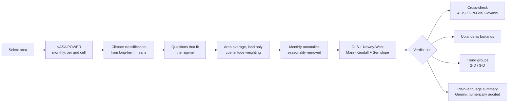

<p align="center">
  
</p>

<p align="center">
  <a href="#run-it">Run it</a> &nbsp;·&nbsp;
  <a href="#data-sources">Data</a> &nbsp;·&nbsp;
  <a href="#how-a-verdict-is-decided">How a verdict is decided</a> &nbsp;·&nbsp;
  <a href="#scientific-integrity">Scientific integrity</a> &nbsp;·&nbsp;
  <a href="#example-results">Example results</a> &nbsp;·&nbsp;
  <a href="docs/validation.md">Validation</a> &nbsp;·&nbsp;
  <a href="docs/demo_stories.md">Demo stories</a>
</p>

<p align="center">
  
  
  
  
</p>

---

Most arguments about climate are not won with data. Someone says the winter was mild, someone else says last year was worse, and the conversation stops there. The numbers that would settle it are public — NASA has been releasing them for forty-five years — but no one looks, because looking means downloading, aligning and testing 45 years of monthly files for one piece of ground.

**Trend Detective** does that in under two seconds, for any area on Earth. Draw a loop on a map, or press **Use my location**, and the application reads the NASA POWER grid cells under it, classifies the local climate from the area's own long-term means, proposes the questions that matter there, and returns a verdict: *significant*, *possible*, or *no clear trend*, with the rate per decade and its 95 % confidence interval. The verdict is tested twice (parametric and non-parametric, and both must agree) and checked against an independent NASA dataset (AIRS or GPM IMERG, served live by NASA Giovanni).

The tests live in [`td/analyze.py`](td/analyze.py) and the checks live in the test suite. Our back-end only carries numbers: the verdict is whatever the two tests and the cross-check say, not what we want them to say.

**NASA Space Apps Challenge 2026 — *Be An Earth System Trend Detective*.**

## Demo

<p align="center">
  
</p>

<p align="center"><sub>MERRA-2 reanalysis and the AIRS satellite over Tunis, 2002–2025: two independent sources, the same warming (<i>r</i> = 0.86). The year-by-year chart is in the panel after every verdict, when Earthdata credentials are set.</sub></p>

## How a verdict is decided

| Tier | When | What the user sees |
|---|---|---|
| **Significant** | Both the parametric test (OLS with Newey-West standard errors) and the rank test (Mann-Kendall with Hamed-Rao correction) give *p* < 0.05 *and* agree on the sign | The trend sentence, the rate per decade, its 95 % confidence interval, and the cross-check with AIRS or GPM IMERG |
| **Possible** | Only one test clears *p* < 0.05, or the two disagree on direction | The same numbers with the word *possible*, and a note on what would be needed for a confident call |
| **No clear trend** | Neither test clears, or the confidence interval includes zero | A plain statement that 45 years are not enough to see a change in this variable here, and the cross-check for comparison |

A decade-by-decade decomposition and a season-by-season decomposition are run alongside; a season is only called *fastest* when its 95 % confidence interval clears every other season's. When the selected area spans ≥ 500 m of elevation, uplands and lowlands are tested separately; *faster* is only reported when the two intervals do not overlap.

<p align="center">
  
</p>

## The pieces

| | Where | Role |
|---|---|---|
| **Map and dashboard** | `web/static/` | A single page with a Leaflet map, a drawing tool, a search box over a bundled list of places, and a Plotly dashboard. No build step; `app.js`, `app.css` and `index.html` are hand-written. Simple and Expert modes share one state. |
| **Grid and land mask** | `web/static/grid.js`, `web/static/land.json` | NASA POWER's 0.5° × 0.625° cell maths and a ring search for nearest land, so a loop smaller than one cell or one drawn over the sea still yields an answer; added cells are drawn with a dashed outline. Land polygons come from Natural Earth (1:110m, public domain). |
| **Server** | `web/server.py` | The standard-library HTTP server. One JSON API, one static page, no framework. Every long operation is cached on disk. |
| **NASA client** | `td/fetch.py` | The NASA POWER client. Pulls monthly point data for each cell, applies the land mask, averages with cos-latitude weights, and reads elevation. |
| **Cross-check** | `td/giovanni.py` | AIRS temperature and GPM IMERG precipitation, fetched live from NASA Giovanni with `harmony-py`, cached on disk, rate-limited. |
| **Statistics** | `td/analyze.py` | The two trend tests, the 95 % confidence intervals, the verdict logic, the season and decade decompositions, the upland / lowland partition and the cross-check correlation. |
| **Per-cell map** | `td/trendmap.py` | Each cell tested on three variables, false-discovery correction with Benjamini-Hochberg at *q* = 0.10, and a cluster tree for the Groups view. |
| **Climate typing** | `td/questions.py` | The area's climate regime from its own long-term means — cold and snowy, desert, warm and dry, hot and humid, or temperate — and the list of questions that fit it. |
| **Plain-language summary** | `td/explain.py` | A short paragraph written by Google Gemini from the application's own numbers, with a numerical and claim validator that rejects any figure the back-end did not compute and any unsupported *"datasets agree"* line. |
| **Tests** | `tests/` | 100 tests, fully offline (NASA and Gemini mocked). One JavaScript test for the grid maths runs under Node when available. |

## NASA services

| Service | Used for |
|---|---|
| **NASA POWER** (MERRA-2 reanalysis), monthly point API | The core series: `T2M`, `T2M_MAX`, `T2M_MIN`, `FROST_DAYS`, `PRECTOTCORR`, `PRECSNOLAND`, `SNODP`, `GWETTOP`, `GWETROOT`, `EVPTRNS`, `RH2M`, elevation. 1981–2025, no login. |
| **AIRS / Aqua** (`AIRS3STM` v7.0) via NASA Giovanni | Surface air temperature cross-check (day / night mean, 2002–2025). Earthdata Login. |
| **GPM IMERG** monthly (`GPM_3IMERGM` v07) via NASA Giovanni | Precipitation cross-check (1998–2025). Earthdata Login. |
| **Natural Earth** (bundled) | 1:110m land polygons for the land mask (public domain). |

All units and variable names were verified against each provider's metadata. Two conventions are worth stating up front: `PRECTOTCORR` includes rain plus the water-equivalent of melted snow, and `T2M_MAX` / `T2M_MIN` are the most extreme values reached in each month, not monthly averages.

## How the pieces fit



## Scientific integrity

The application is designed to **describe** a change, not to explain it. Every verdict ends with the same line: *"This shows a change, not its cause."* The rules below are built into the back-end and apply to every report.

| Rule | Where it lives |
|---|---|
| A trend is called *significant* only when both tests clear *p* < 0.05 and agree on direction | [`td/analyze.py`](td/analyze.py) |
| In a per-cell map, a cell counts as significant only after Benjamini-Hochberg FDR correction at *q* = 0.10 | [`td/trendmap.py`](td/trendmap.py) |
| Trend groups describe the data; they are not tests. Significance stays with each cell's own verdict | [`td/trendmap.py`](td/trendmap.py) |
| The two datasets in a cross-check are only partially independent (MERRA-2 assimilates AIRS radiances and gauge records); the report says so every time | [`td/giovanni.py`](td/giovanni.py) |
| The language model writes words, not numbers. Any figure the back-end did not compute, any un-supported *"datasets agree"* line, or any causal word triggers rejection of its output | [`td/explain.py`](td/explain.py) |

## Example results

Live numbers, November 2026. Each case is encoded in the page address, so a link reopens it exactly.

| Area | Finding |
|---|---|
| **Tunis** | Air temperature **+0.20 °C / decade** since 1981 (significant, both tests clear). AIRS and MERRA-2 agree on warming since 2002 (*r* = 0.86). Precipitation: no clear trend in either dataset (*r* = 0.94). |
| **Riyadh** | Hottest day of the month **+0.36 °C / decade** since 1981 (significant). |
| **Manitoba, Canada** | Coldest-night temperature **+0.43 °C / decade** (significant). Snow cover: no clear change yet. |
| **High Atlas, Morocco** | Higher ground +0.37, lower ground +0.31 °C / decade; the gap is inside the uncertainty, so the application does not call one faster. |

## Run it

Requires Python 3.12 or newer. No build step, no npm, no Docker.

```bash
git clone https://github.com/R4Y3NN-k/nasa_trend_detective.git
cd nasa_trend_detective
python -m venv .venv
source .venv/bin/activate          # Windows: .venv\Scripts\activate
pip install -r requirements-dev.txt
python -m pytest -q                # 100 tests, fully offline
python -m web.server               # open http://localhost:8600
```

The first Streamlit prototype is still runnable with `streamlit run app.py`; the map-first application (the one in the screenshots above) is `web.server`.

### Optional credentials

The application works with no keys at all. Without them, the cross-check falls back to *single-source only* and the plain-language summary is produced from a deterministic template. To turn them on, copy `.env.example` to `.env` and fill:

| Key | Enables | Source |
|---|---|---|
| `EARTHDATA_USERNAME`, `EARTHDATA_PASSWORD` | Live AIRS / GPM cross-check | Free account at [urs.earthdata.nasa.gov](https://urs.earthdata.nasa.gov/users/new) |
| `GEMINI_API_KEY` | Plain-language summary and question suggestions | Free key at [aistudio.google.com/apikey](https://aistudio.google.com/apikey) |

`.env` is in `.gitignore`. Never commit it.

Every NASA response is cached under `data/cache/`, so an area is fast the second time. Before a live demonstration, pre-warm the cache with `python scripts/prefetch_demo.py --giovanni`.

### Using the map

| Control | Action |
|---|---|
| ✋ Hand (default) | Pan, scroll to zoom, arrow keys |
| ✏️ Pen | Draw a loop around an area; **Shift + drag** draws from any tool |
| ⁘ Points | Tap grid cells one by one (up to 30) |
| ↶ Undo | Reverse the last selection change (**Ctrl / Cmd + Z**); **Esc** leaves the pen |
| 🔍 Search box | Jump to a bundled place (capitals and large cities, no third-party service). **Investigate this area** selects a ≈ 2° × 2° box; **Use my location** selects a smaller box that expands on coastlines until enough land is included |

After **Investigate**, the panel shows the verdict, decade bars, the plain-language summary, the cross-check, the seasonal breakdown, and the upland / lowland partition where applicable. The Expert mode adds the test statistics and five tabs: **Time series**, **Zones** (per-cell tests with FDR correction), **Groups** (2-D / 3-D), **Evidence**, and **Method**.

## Repository

```
web/server.py        Application server: JSON API + static page (stdlib HTTP, no framework)
web/static/          index.html, app.css (hand-written, no build step), app.js, grid.js
                     (cell maths and nearest-land ring search), places.js (bundled search
                     list), land.json (Natural Earth 1:110m land, public domain).
                     Leaflet map, Plotly charts.
td/fetch.py          NASA POWER client, grid, land mask, cos-latitude area average, elevation
td/giovanni.py       AIRS and GPM IMERG via Giovanni (harmony-py), cache, quota
td/analyze.py        Trend tests, verdict logic, agreement(), compare()
td/trendmap.py       Per-cell trends with FDR control, trend-group clustering
td/questions.py      Climate typing and the questions that fit each regime
td/explain.py        Gemini summaries with numerical and claim validation
tests/               Offline tests (NASA and Gemini mocked); grid_check.js runs under Node
docs/                Validation notes, demo stories, task reference
scripts/             prefetch_demo.py and other local helpers
```

## Limits

This is hackathon software. It has not been peer-reviewed, and nothing in it is a substitute for a climate scientist's report. Four things are worth stating plainly:

- **Forty-five years is not forever.** Some real trends are too slow to see over 1981–2025. The verdict *no clear trend* is honest about that; it is not proof of no change.
- **Reanalyses are models, not measurements.** MERRA-2 (the back-end of NASA POWER) assimilates observations but is still a model. We quote it as the primary source because it is the one global, consistent, 45-year grid at this resolution.
- **The cross-check is not a referee.** AIRS and GPM IMERG are the independent instruments we trust most here, but no dataset is fully independent of the global observing system.
- **The language model writes words, not numbers.** Even with the validator, read the figures from the panel, not from the paragraph.

## Team

R4Y3NN-k (data) · yahya0X (dashboard) · stats · content.
Module ownership is in [`PLAN.md`](PLAN.md).

---

<sub>AI-assisted: portions of this repository were drafted with Claude (Anthropic) and reviewed by the team. Plain-language summaries in the application are produced by Google Gemini and labelled accordingly. Map tiles © OpenStreetMap contributors. No NASA logos are used.</sub>
