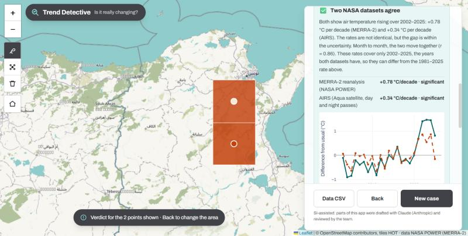
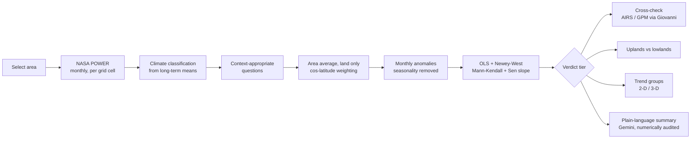

# Trend Detective

A web application that quantifies and communicates climate trends for any
area on Earth using 45 years of NASA observations. Every verdict is
double-tested and cross-checked against an independent NASA dataset.

**NASA Space Apps Challenge 2026 — *Be An Earth System Trend Detective*.**


---

## Overview

Trend Detective turns a question that is often answered with opinions —
*"Is the climate changing here?"* — into a reproducible measurement with
calibrated uncertainty. The user selects an area on a world map; the
application retrieves the relevant NASA POWER grid cells, classifies the
local climate from long-term means, suggests climate-appropriate questions,
and returns a verdict with a per-decade rate and a 95 % confidence interval.
An independent satellite dataset (AIRS or GPM IMERG, served via NASA
Giovanni) is used as a cross-check.

| User action | System response |
| --- | --- |
| **Watch an example**, **Use my location**, draw a loop, or tap cells | Fetches NASA POWER monthly data at 0.5° × 0.625° resolution; sea cells are excluded |
| Wait ≈ 2 s | Reads the area's climate from its own NASA climatology and proposes questions that fit the regime |
| Click **Investigate** | Runs two independent trend tests and returns a verdict — *significant*, *possible*, or *no clear trend* — with a per-decade rate and 95 % CI |
| Review the report | Cross-checks with a second NASA dataset; compares uplands with lowlands; clusters cells that change alike |

---

## Key features

- **Dual-test verdict.** A trend is reported as *significant* only when both
  an OLS regression with Newey-West standard errors and a non-parametric
  Mann-Kendall test (Hamed-Rao variance correction) yield *p* < 0.05 and
  agree on the sign of the change.
- **Independent cross-check.** MERRA-2 temperatures are compared with the
  **AIRS** instrument on NASA's *Aqua* satellite; precipitation with
  **GPM IMERG**. Both are fetched live from NASA Giovanni over the years the
  two datasets share.
- **Climate-adaptive questioning.** The question set — cold and snowy,
  desert, warm and dry, hot and humid, or temperate — is derived from the
  area's own long-term means, not from a country list, so the Alps and the
  Rockies receive the same questions.
- **Elevation partitioning.** When an area spans ≥ 500 m of elevation, uplands
  and lowlands are tested separately. A difference is reported only when the
  95 % confidence intervals do not overlap.
- **Trend grouping.** Each grid cell is tested on three variables and cells
  with similar trend signatures are assigned a shared colour on the map, a
  2-D plot, and an optional 3-D projection.
- **Decadal and seasonal decomposition.** Mean anomaly per decade, and the
  full test battery applied to each season. A season is labelled *fastest*
  only when its 95 % CI clears every other.
- **Robust area selection.** Loops smaller than one grid cell, or drawn over
  water, trigger a ring search for the nearest land cells (indicated by a
  dashed outline). **Use my location** draws a compact box and expands it on
  coastlines until it contains enough land to analyse.
- **Area comparison.** Run the same variable over the same years on a second
  area; *faster* is reported only when the two 95 % CIs do not overlap.
- **Inline definitions.** Every variable and every statistic (trend,
  anomaly, 95 % CI, *p*-value, *q*-value) carries a one-line definition
  behind an (!) marker.
- **Simple and Expert modes.** A single switch. Simple displays the verdict
  sentence, decade bars, seasonal summary, and cross-check. Expert adds both
  test statistics, per-cell maps with FDR-controlled *q*-values, Groups, and
  CSV / JSON exports. Both modes report identical numbers.
- **Plain-language summary.** Written by Google Gemini from the application's
  own numerical outputs. Any figure or claim not computed by the back-end
  triggers an automatic rejection and a template is used instead.
- **Shareable cases.** Cells, years, question, and detail level are encoded
  in the URL, so a case can be sent to a class. A one-page printable report
  is one click away.



---

## Architecture



---

## Data sources

| Source | Variables | Period | Access |
| --- | --- | --- | --- |
| [NASA POWER](https://power.larc.nasa.gov/) (MERRA-2 reanalysis), monthly point API | Air temperature `T2M`, monthly max / min `T2M_MAX` / `T2M_MIN`, frost days `FROST_DAYS`, precipitation `PRECTOTCORR`, snowfall `PRECSNOLAND`, snow depth `SNODP`, topsoil wetness `GWETTOP`, root-zone soil wetness `GWETROOT`, evapotranspiration `EVPTRNS`, relative humidity `RH2M`, elevation | 1981 – 2025 | None |
| **AIRS / Aqua** (`AIRS3STM` v7.0) via [Giovanni](https://giovanni.gsfc.nasa.gov/) | Surface air temperature, day / night mean, K → °C | 2002 – 2025 | NASA Earthdata |
| **GPM IMERG** monthly (`GPM_3IMERGM` v07) via Giovanni | Precipitation, mm/hr → mm/day | 1998 – 2025 | NASA Earthdata |

Units and variable names were verified against each provider's metadata.
Notes: `PRECTOTCORR` includes rain plus melted snow water-equivalent;
`T2M_MAX` and `T2M_MIN` are monthly extremes, not monthly means.

---

## Installation

Requires Python 3.12 or newer.

```bash
git clone https://github.com/R4Y3NN-k/nasa_trend_detective.git
cd nasa_trend_detective
python -m venv .venv
source .venv/bin/activate          # Windows: .venv\Scripts\activate
pip install -r requirements-dev.txt
python -m pytest -q                # 100 tests, fully offline
python -m web.server               # application at http://localhost:8600
```

The initial Streamlit prototype is retained: `streamlit run app.py`.

### Optional credentials

API keys are optional. Without them, the cross-check falls back to
"single-source only" and the summary is produced from a deterministic
template.

| Key | Enables | Source |
| --- | --- | --- |
| `EARTHDATA_USERNAME`, `EARTHDATA_PASSWORD` | Live AIRS / GPM cross-check | [urs.earthdata.nasa.gov](https://urs.earthdata.nasa.gov/users/new) |
| `GEMINI_API_KEY` | Plain-language summary and question suggestions | [aistudio.google.com/apikey](https://aistudio.google.com/apikey) |

Copy `.env.example` to `.env`; never commit `.env`. All NASA responses are
cached under `data/cache/`. Before a live demonstration, pre-warm the cache
with `python scripts/prefetch_demo.py --giovanni`.

---

## Using the map

| Control | Action |
| --- | --- |
| Hand (default) | Pan, scroll to zoom, arrow keys |
| Pen | Draw a loop; **Shift + drag** draws from any tool |
| Points | Tap grid cells (up to 30) |
| Undo | Reverse the last selection change (**Ctrl / Cmd + Z**); **Esc** exits the pen |
| Search box | Jump to a bundled place (capitals and large cities, no third-party service). **Investigate this area** selects a ≈ 2° × 2° box; **Use my location** selects a smaller box that expands on coastlines until enough land is included |

After **Investigate**, the panel displays the verdict, decadal bars, the
plain-language summary, the cross-check, the seasonal breakdown, and the
upland / lowland partition where applicable. The Expert mode adds the test
statistics and five tabs: **Time Series**, **Zones** (per-cell tests with
FDR correction), **Groups** (2-D / 3-D), **Evidence**, and **Method**.

Interface-pass screenshots (desktop and mobile): [docs/img/ui-pass/](docs/img/ui-pass/).


---

## Scientific integrity

- A trend is described, never explained. Every verdict concludes:
  *"This shows a change, not its cause."*
- With many cells tested simultaneously, a cell is reported as significant
  only after Benjamini-Hochberg FDR correction at *q* = 0.10.
- Trend groups are descriptive and are not statistical tests; significance
  remains attached to each cell's own verdict.
- The two datasets in a cross-check are only partially independent — MERRA-2
  assimilates AIRS radiances and gauge records. The application states this
  limitation in every cross-check report.
- The language model writes text, not numbers. Any numerical value not
  computed by the back-end, any unsupported *"datasets agree"* claim, or any
  causal word causes the model's output to be rejected.

---

## Example results (live data, November 2026)

| Area | Finding |
| --- | --- |
| Tunis | Air temperature **+0.20 °C / decade** since 1981 (significant). AIRS and MERRA-2 agree on warming since 2002 (*r* = 0.86). Precipitation: no clear trend in either dataset (*r* = 0.94). |
| Riyadh | Monthly maximum **+0.36 °C / decade** (significant). |
| Manitoba (Canada) | Coldest-night temperature **+0.43 °C / decade** (significant). Snow cover: no clear change. |
| High Atlas (Morocco) | Uplands +0.37 vs lowlands +0.31 °C / decade; difference within uncertainty. |

---

## Repository layout

```
web/server.py        Application server: JSON API + static page (stdlib HTTP)
web/static/          index.html, app.css (no build step), app.js, grid.js
                     (cell maths, nearest-land ring search), places.js,
                     land.json (Natural Earth 1:110m, public domain).
                     Leaflet map, Plotly charts.
td/fetch.py          NASA POWER client, grid, land mask, area averaging, elevation
td/giovanni.py       AIRS and GPM IMERG via Giovanni (harmony-py), cache, quota
td/analyze.py        Trend tests, verdict logic, agreement(), compare()
td/trendmap.py       Per-cell trends with FDR control, trend-group clustering
td/questions.py      Climate typing and question selection
td/explain.py        Gemini summaries with numerical and claim validation
tests/               Offline tests (NASA and Gemini mocked); grid_check.js runs
                     under Node.
```

---

## Team

R4Y3NN-k (data) · yahya0X (dashboard) · stats · content.
See `PLAN.md` for ownership per module.

---

*AI-assisted: portions of this repository were drafted with Claude
(Anthropic) and reviewed by the team. Plain-language summaries in the
application are produced by Google Gemini and labelled accordingly. Map
tiles © OpenStreetMap contributors. No NASA logos are used.*
